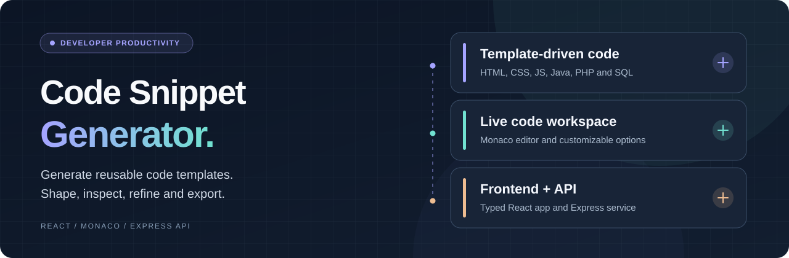

<p align="center"></p>

<h1 align="center">Code Snippet Generator</h1>

<p align="center"><strong>A practical code template generator for HTML, CSS, JavaScript, Java, PHP and SQL — with a Monaco editor and a separate Node.js API.</strong></p>

<p align="center"><a href="README.fr.md">Lire en français</a> · <a href="#overview">Overview</a> · <a href="#features">Capabilities</a> · <a href="#architecture">Architecture</a> · <a href="#start">Quick start</a> · <a href="#quality">Quality</a> · <a href="#faq">FAQ</a> · <a href="#license">License</a></p>

<p align="center"><a href="LICENSE"></a> </p>

<a id="overview"></a>
## Project overview

Code Snippet Generator helps users configure, inspect and export commonly needed coding templates instead of assembling the same boilerplate repeatedly. It combines a React interface with a TypeScript/Express backend for template selection, option validation and generation. The current product is **template-driven**, not a claim of AI-powered code generation.

**Who is it for?** Developers, technical students and product builders who want a starting point for repetitive code structures.

**Typical use case:** Select a language and template, configure its options, inspect generated code in the Monaco editor, then copy or export it as a starting point for an application.

<a id="features"></a>
## Core capabilities

| Capability | What it does |
| --- | --- |
| **Six languages** | HTML5, CSS3, JavaScript, Java, PHP and SQL template categories. |
| **Configurable templates** | Parameters and grouped options submitted to the generation service. |
| **Monaco integration** | Editable code workspace using Microsoft's Monaco Editor. |
| **Frontend + API separation** | React client, Express routes and server-side template logic. |
| **Validation** | Zod and template validation utilities in the generation workflow. |
| **Documentation and checks** | Architecture, setup guides, tests and several GitHub Actions workflows. |

<a id="architecture"></a>
## Architecture and technical choices

The repository uses npm workspaces: frontend/ contains the React and TypeScript client; server/ contains Express endpoints, template data and the generation pipeline. The root coordinates development, build and tests. The UI communicates with the API and is **not** a standalone static code generator by default.

**Technologies:** React, TypeScript, Vite, Zustand, Monaco Editor, Node.js, Express and Zod. The frontend uses Vitest; the backend uses Jest. Generated code is a development starting point and requires review, testing and adaptation before production use.

<a id="start"></a>
## Getting started

**Requirements:** Node.js 20 or newer and npm 10 or newer, as declared by the root project. Run both workspaces to use the full code generation workflow.

```bash
git clone https://github.com/hrmonic/code-snippet-generator.git
cd code-snippet-generator
npm ci
npm run dev
```

Useful scripts: npm run build, npm run test, npm run lint and npm run type-check. The frontend and backend can also be started separately using npm run dev:frontend and npm run dev:server.

<a id="quality"></a>
## Quality, security and limitations

The repository includes frontend and backend tests, template validation, linting, type checks and CI workflows. These demonstrate an emphasis on maintainability; they do not make every emitted snippet automatically secure or production-ready.

### Known limitations and safeguards

- The GitHub Pages workflow publishes frontend files only; the Express API must be available separately for live generation.
- Generated output is template-based; calling it AI-generated code would be misleading.
- Templates must be reviewed for correctness, security and compatibility in their target projects.
- The previous README used version claims that were inconsistent with the root package version; the new overview avoids unverified release claims.

### Next improvements

- Provide an end-to-end hosted demonstration with a functioning API.
- Add reproducible examples of generated output and screenshots.
- Publish a clear compatibility matrix and template-specific tests.

### Further documentation

- [Setup guide](docs/setup.md)
- [Architecture](docs/architecture.md)
- [API reference](docs/api.md)
- [Template engine](docs/template-engine.md)
- [Contributing](CONTRIBUTING.md)

<a id="faq"></a>
## Frequently asked questions

### Does it generate code with an AI model?

No mandatory LLM is part of the documented generation path. It uses structured templates and configurable options.

### Which languages are supported?

The repository documents template categories for HTML5, CSS3, JavaScript, Java, PHP and SQL.

### Can the GitHub Pages frontend generate code on its own?

The full workflow uses a Node/Express API, which must also be deployed or running.

### Is the generated code guaranteed production-ready?

No. Treat generated code as a starting point and review, test and adapt it before use.

<a id="license"></a>
## License and maintainer

Released under the **[MIT License](LICENSE)**. Contributions and reuse are governed by the license and the existing [contribution guide](CONTRIBUTING.md).

**Created and maintained by** [Réda Touzani (@hrmonic)](https://github.com/hrmonic).

---

*Make repetitive code generation easier without hiding the code developers need to understand.*
